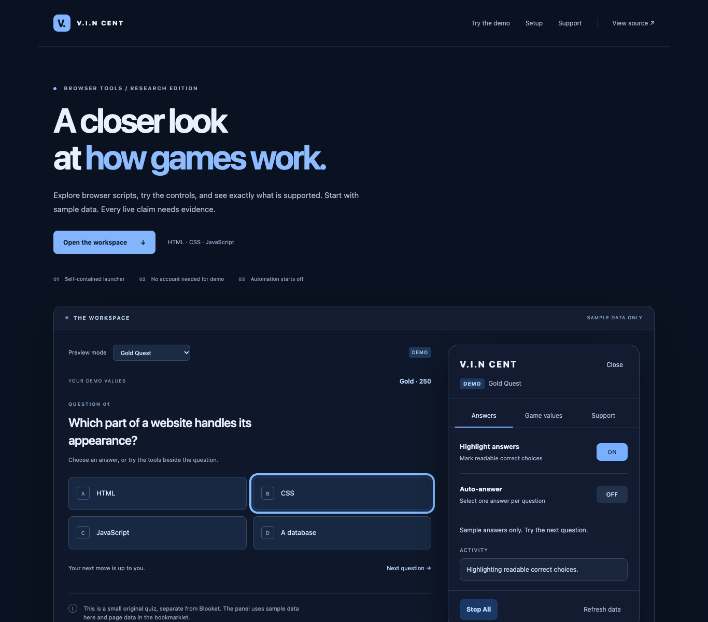

# V.I.N.C.E.N.T

A small browser-tool research project, an interactive mockup, and a self-contained Blooket bookmarklet. Written in HTML, CSS and JavaScript.

**The answer prompter can now use a local key from a question-set review. Review copying works in Safari, and prompting passes controlled game tests. Your live-game confirmation is still needed. Auto-answer and value editing remain unsupported in the checked Gold Quest layout. Chromebook hardware and Windows 11 remain untested.** Blooket’s [terms](https://www.blooket.com/terms) prohibit unauthorized cheats and scripts.



## Open the mockup

Download the repository ZIP, extract it, and open **index.html** in Chrome or Edge. Built files are included, so you do not need Node.js to try it. It uses sample questions and values without a Blooket login.

- Switch between every current named mode or variant.
- Try answer highlighting, auto-answer, and sample value edits.
- Stop All ends automation. Close removes the panel; you can reopen it.
- Search the support table to see which features still need live testing.

## Use the bookmarklet

From the mockup’s Setup section, drag **V.I.N.C.E.N.T** to your bookmarks bar, or copy the address into a new bookmark’s URL field. Open a Blooket game and select the saved bookmark.

For the new prompter, follow the [review-key steps](docs/ANSWER-PROMPTER.md): show the review answers, copy the key, load it in the game panel, then turn on Highlight answers. It matches question text, picture, audio and choices. It leaves unknown questions unmarked. Auto-answer is disabled while a key is loaded. Copied review keys appear in the GUI immediately and can be downloaded as a JSON file for sharing.

The panel starts with all tools off. Missing answer data disables answer controls unless a review key is loaded. Only mapped, finite numeric fields on a React class component are offered for editing. Value updates are labelled local and never claimed as server-confirmed. Hook-based answers can be read when the expected question shape is exposed; hook-only value editing is not implemented.

The launcher recognises mode hosts such as `gold.blooket.com` as well as older `play.blooket.com` routes. Safari launcher opening and Gold Quest detection have been checked. In the tested live game, usable correctness data appeared only after a manual answer, and the older value-editing API was absent. Replace a saved bookmark’s full address after updates, because its code is self-contained. See the [Safari steps](docs/SETUP.md#safari-on-mac).

The bookmarklet contains all its code. It does not download another script, collect credentials, send analytics, or call a private game endpoint. A click or state update can still trigger the game’s normal network effects. Readable source is under `src/`; generated launcher files are under `dist/`.

## Research and setup

- [How the scripts work, with sources](docs/RESEARCH.md)
- [Chromebook and Windows 11 setup](docs/SETUP.md)
- [All modes and live support status](docs/SUPPORT.md)
- [Machine-readable feature/context records](docs/support.json)
- [Tests and their limits](docs/VALIDATION.md)

There are 28 named modes/variants and 45 play-context records. Coco Cabana and Cocoa Cottage have separate entries. Newer modes without researched value fields show **Unsupported in v1**, while their generic answer readers remain **Not tested** against live games.

## Develop

Use Node.js 22 or newer:

```sh
npm ci
npm run build
npm start
```

Open the printed local address, normally `http://127.0.0.1:43917`.

```sh
npx playwright install chromium
npm test
```

If you already have a compatible Chromium binary, set `VIN_CHROMIUM_PATH` to its executable path. No global packages are needed. Browser tests use an isolated mock origin and an actual React 18 fixture. They do not access Blooket. Tests refuse to reuse another preview server.

`npm run build` bundles the runtime, produces the bookmark address, and regenerates the support documents. Live evidence is kept separate from local tests and public-review checks. Update evidence in the generator together with the validation notes; never infer live support from fixture tests.

## Project layout

- `src/adapters/`: bounded React readers and a mode-specific adapter factory.
- `src/modes.js`: official names/access types, candidate routes and historical numeric field mappings.
- `src/runtime.js`: shared panel, automation and cleanup.
- `src/answer-key.js`: validated local keys and exact question matching.
- `src/demo.js`: sample data connected to the same panel.
- `scripts/`: build and loopback-only local server.
- `tests/`: unit checks and controlled browser tests.

No user account, backend or public API is required. This project is independent of Blooket. Original code is MIT licensed; linked third-party projects retain their own terms.
